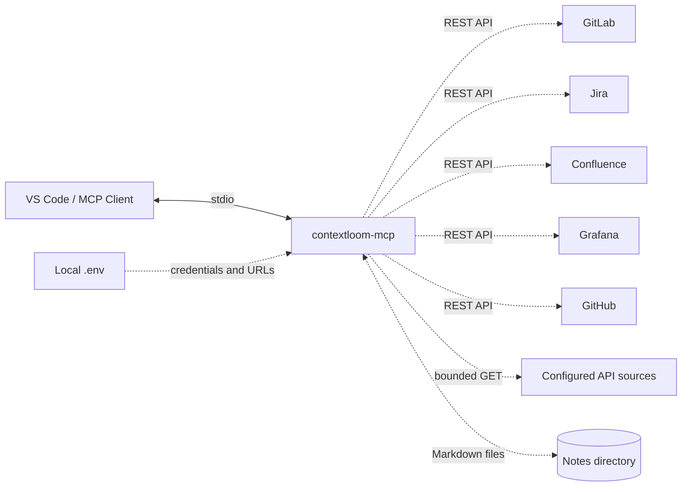

# contextloom-mcp

_Renamed from `gitlab-jira-context-mcp`; GitHub redirects the old URL._

<p align="center">
  
  
  
  
  
  
</p>

A local Model Context Protocol (MCP) server that connects GitLab project and merge-request context with Jira work tracking, Confluence pages, Grafana dashboards, optional GitHub repository context, any HTTPS JSON API you describe in a config file, and a durable set of Markdown notes. Every integration is optional, every response is bounded and redacted, and every write requires explicit confirmation.

The server uses stdio and runs on your machine. It sends requests only to the service URLs that you configure locally.

## Architecture



The server never exposes an HTTP endpoint. Tokens stay in your local `.env` file or process environment. The only data it persists is the notes directory, and only when you configure one.

## Included Tools

| Tool | Description |
| --- | --- |
| `contextloom_status` | Report which integrations are configured, without secrets or a live connectivity claim. |
| `gitlab_list_projects` | List projects visible to the configured GitLab token. |
| `gitlab_get_project` | Get a project by ID or path. |
| `gitlab_list_merge_requests` | List merge requests, optionally for one project. |
| `gitlab_get_merge_request` | Get a merge request and its metadata. |
| `gitlab_list_pipelines` | List recent CI/CD pipelines for a project. |
| `gitlab_get_file` | Get a repository file at a branch, tag, or commit. |
| `jira_get_my_issues` | List issues assigned to the authenticated Jira user. |
| `jira_get_issue` | Get an issue by key, including comments. |
| `jira_search_issues` | Search issues with JQL. |
| `jira_get_transitions` | List workflow transitions available for an issue. |
| `jira_get_changelog` | Get issue status and field history. |
| `jira_list_comments` | List comments on an issue with `startAt` pagination. |
| `jira_list_worklogs` | List worklog entries on an issue with `startAt` pagination. |
| `jira_add_comment` | Add a comment after passing `confirm: true`. |
| `jira_add_worklog` | Add a worklog entry after passing `confirm: true`. |
| `confluence_get_page` | Get a Confluence page and its stored content. |
| `confluence_search` | Search Confluence content with CQL. |
| `grafana_search_dashboards` | Search dashboards visible to the configured service account. |
| `grafana_get_dashboard` | Get a Grafana dashboard by UID. |
| `github_get_authenticated_user` | Verify access for the configured GitHub token. |
| `github_list_repositories` | List repositories visible to the configured token. |
| `github_get_repository` | Get repository metadata by owner/name. |
| `github_get_file_content` | Read one repository file at a branch or ref. |
| `github_create_or_update_file` | Create or update one UTF-8 text file after passing `confirm: true`. |
| `api_list_sources` | List configured API sources and whether their credentials are present. |
| `api_get` | One bounded, read-only GET against a configured API source, with field selection and paging. |
| `notes_search` | Search durable notes; results carry `current`, `stale`, `expired` or `unverified` freshness. |
| `notes_get` | Read one note in full, including sources. |
| `notes_save` | Save or update one verified note with sources, `verifiedAt` and optional `expiresAt`. |

Tools appear only for integrations whose settings are complete, so the server starts with nothing configured and exposes just `contextloom_status`. Every tool carries MCP annotations (`readOnlyHint`, `openWorldHint`) so clients can apply their own approval policy. Jira mutations and GitHub file writes additionally require `confirm: true` and use the permissions of the configured token.

Jira search, comments, and worklogs return the service's pagination metadata. When `total` exceeds the number of returned entries, call the same tool with a later `startAt` value. `jira_add_worklog` accepts Jira duration syntax such as `1h 30m` and an optional ISO 8601 `started` timestamp.

## Repository Structure

```text
contextloom-mcp/
├── src/
│   ├── client.ts       # Service clients, output budget and result formatting
│   ├── http.ts         # Bounded requests: timeout, no redirects, response size cap
│   ├── redact.ts       # Credential redaction for output and error messages
│   ├── oauth.ts        # Cached OAuth2 client-credentials provider
│   ├── sources.ts      # Configured API sources and bounded GET
│   ├── notes.ts        # Markdown notes with provenance and freshness
│   ├── proxy.ts        # Proxy-aware fetch dispatcher shared by every client
│   ├── config.ts       # GitLab instance resolution (single host or GITLAB_INSTANCES)
│   └── server.ts       # MCP tool registration, annotations and optional groups
├── test/               # Unit tests plus a real stdio server test
├── examples/           # API source configuration example
├── docs/               # Design notes and lessons learned
├── .env.example        # Neutral local configuration template
├── package.json        # Scripts and dependencies
└── tsconfig.json       # TypeScript configuration
```

## Requirements

- Node.js 20.18.1 or newer
- An MCP client with stdio server support, such as Visual Studio Code with GitHub Copilot
- Credentials only for the integrations you want: a GitLab personal access token (or several, via `GITLAB_INSTANCES`), a Jira or Confluence Server/Data Center personal access token, a Grafana service account token with dashboard read access, a GitHub fine-grained token (contents write only for `github_create_or_update_file`), and whatever your configured API sources reference

## Quick Start

1. Clone the repository and install dependencies.

   ```bash
   git clone https://github.com/jagarkarlo/contextloom-mcp.git
   cd contextloom-mcp
   npm install
   npm test
   npm run build
   ```

2. Create your local configuration.

   ```bash
   cp .env.example .env
   ```

    Fill in only the integrations you use; each one turns on when its settings are complete. Use `GITLAB_INSTANCES` instead of the single GitLab pair to talk to more than one host. `GITHUB_API_BASE_URL` is optional for GitHub Enterprise Server. Set `HTTPS_PROXY`/`NO_PROXY` only if reaching one of these hosts needs a corporate proxy. Keep `.env` local; it is ignored by Git. Call `contextloom_status` after starting to see what is enabled.

3. Register the compiled server in your MCP client. In VS Code, run `MCP: Open User Configuration` and add this entry to the `servers` object. Replace `/absolute/path/to` with the cloned repository path.

   ```json
   {
     "servers": {
       "contextloom": {
         "type": "stdio",
         "command": "node",
         "args": [
           "/absolute/path/to/contextloom-mcp/dist/server.js"
         ]
       }
     }
   }
   ```

4. Restart the server from `MCP: List Servers` or reload VS Code.

## Configured API sources

Point `CONTEXTLOOM_API_SOURCES` at a JSON file to give agents bounded, read-only access to any HTTPS JSON API without writing code. See [`examples/api-sources.example.json`](examples/api-sources.example.json).

| Field | Meaning |
| --- | --- |
| `id` | Short name passed as `source` to `api_get`. |
| `baseUrl` | HTTPS base URL; credentials, query strings and fragments are rejected. |
| `auth` | `none`, `bearer` (`tokenEnv`), `header` (`header`, `valueEnv`), `query` (`param`, `valueEnv`) or `oauth-client-credentials` (`tokenUrl`, `clientIdEnv`, `clientSecretEnv`, optional `scope`, `audience`). |
| `allowPaths` | Optional path prefixes; anything else is refused. |

The file holds environment-variable names, never secret values. `api_get` refuses `..`, protocol-relative paths and origin changes, picks a list with `itemsPath`, keeps only the `fields` you name, and pages through it with `offset`/`limit`. OAuth sources cache the token until shortly before expiry and fetch a new one once after a `401`.

## Notes

Set `CONTEXTLOOM_NOTES_DIR` to keep verified, reusable findings as one Markdown file per note under `<dir>/<kind>/<id>.md`, with metadata in an HTML comment at the top. The files are the source of truth: edit them by hand, review them in pull requests, and keep the directory in its own private Git repository for history and revert. `notes_save` refuses credential-like content. Search ranks title, tags, summary and body in that order and reports freshness, so an old or expired note reads as a lead to re-check rather than a fact.

## Multiple GitLab hosts

Every `gitlab_*` tool accepts an optional `instance` argument. With a single
`GITLAB_BASE_URL`/`GITLAB_TOKEN` pair it is unnecessary. With `GITLAB_INSTANCES`
set to a JSON array of `{ "name", "baseUrl", "token" }` objects, pass `instance`
to pick one; omitting it uses the first entry.

## Security

- The server reads credentials only from the local `.env` file or process environment.
- Every upstream request times out after 30 seconds, refuses redirects (a token must never follow a redirect to another origin) and stops reading after 2 MB.
- Tool output is capped at `CONTEXTLOOM_MAX_OUTPUT_CHARS` (default 16,000). Larger results come back as a preview marked `truncated: true`, never silently cut.
- Configured tokens, issued OAuth tokens and common credential formats are redacted from tool output. Upstream errors are reduced to a short redacted hint instead of the raw body.
- Treat every response as untrusted data. Issue text, pages and API payloads can contain instructions; they are not authorization to act.
- Use tokens with the smallest access scope that supports your intended requests.
- Do not place credentials in source files, MCP configuration, notes, issue comments, or commits.
- Verify the issue key, work duration, and content before setting `confirm: true` for a Jira write. `confirm` is an intent check, not authentication.
- Read the existing file with `github_get_file_content` and pass its returned SHA when updating a GitHub file.
- A corporate proxy dispatcher (via `undici`) is only attached for a host when `HTTPS_PROXY`/`HTTP_PROXY` is set and that host is not covered by `NO_PROXY` — Node's global `fetch` does not read those variables on its own, unlike curl.

## Configuration Boundaries

| Integration | Enabled by | Access |
| --- | --- | --- |
| GitLab | `GITLAB_BASE_URL` + `GITLAB_TOKEN`, or `GITLAB_INSTANCES` | Read-only projects, merge requests, pipelines, and repository files. |
| Jira | `JIRA_BASE_URL` + `JIRA_API_TOKEN` | Read issues, comments, worklogs, transitions, and changelog; confirmed comment/worklog writes. |
| Confluence | `CONFLUENCE_BASE_URL` + `CONFLUENCE_API_TOKEN` | Read-only page lookup and CQL search. |
| Grafana | `GRAFANA_BASE_URL` + `GRAFANA_API_TOKEN` | Read-only dashboard search and retrieval. |
| GitHub | `GITHUB_TOKEN` | Read authenticated-user, repository, and file context; confirmed single-file UTF-8 writes. |
| API sources | `CONTEXTLOOM_API_SOURCES` | Read-only, bounded GET against each configured source. |
| Notes | `CONTEXTLOOM_NOTES_DIR` | Local Markdown read and write; no network. |

## Development

Run the checks before committing changes:

```bash
npm test
npm run build
git diff --check
```

`src/http.ts` bounds every request and `src/redact.ts` scrubs everything the model sees. `src/client.ts` holds the service clients and the output budget, `src/sources.ts` and `src/oauth.ts` the configurable API sources, `src/notes.ts` the notes store, and `src/server.ts` registers the tools, their annotations and which groups are enabled. `test/server.test.ts` starts the real server over stdio; add focused tests when changing behavior. [docs/design-notes.md](docs/design-notes.md) explains why each guard exists.

## Roadmap

- GitLab merge-request discussions and project search.
- Optional local index (SQLite FTS5) over notes and selected API sources for faster recall at scale.
- Retained explicit confirmation for every write operation.

## License

This project is licensed under the [MIT License](LICENSE).
